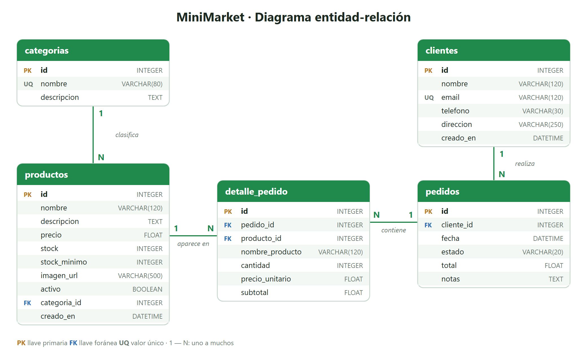
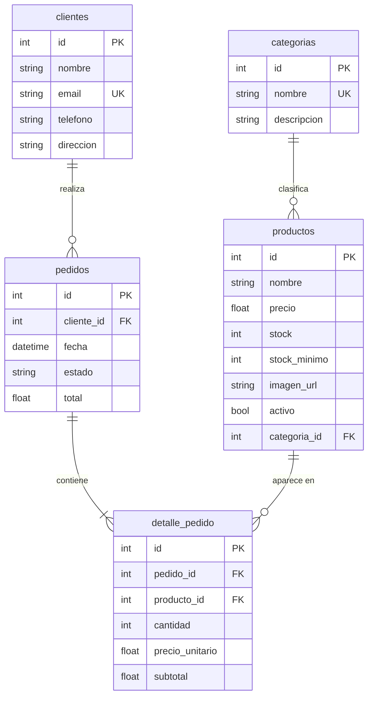

# 🛒 MiniMarket — Tienda en línea

Aplicación web para una tienda pequeña donde los clientes consultan productos y realizan pedidos, y el administrador gestiona el catálogo, el inventario, los pedidos y los clientes.

**Demo:** _(pegar aquí el enlace de Vercel)_

## Descripción

Las tiendas de barrio suelen llevar su inventario y pedidos a mano, lo que provoca errores de stock y de cobro. MiniMarket centraliza todo en una base de datos:

- **Catálogo** de productos con imágenes, precios, búsqueda y filtro por categoría.
- **Carrito de compras** que respeta el stock disponible.
- **Registro y consulta de pedidos**: el total se calcula en el servidor y el inventario se descuenta automáticamente.
- **Panel de administración** con CRUD de productos, categorías, pedidos y clientes.
- **Control de inventario**: alertas de bajo stock, entradas y salidas, y valor total del inventario.

El análisis completo (problema, objetivos, usuarios y diseño de la base de datos) está en [`docs/analisis.md`](docs/analisis.md).

## Tecnologías utilizadas

| Capa | Tecnología |
|---|---|
| Backend | Python 3.12+, FastAPI, SQLAlchemy, Pydantic |
| Base de datos | SQLite |
| Frontend | HTML, CSS, JavaScript (módulos), Bootstrap 5, Bootstrap Icons |
| Control de versiones | Git y GitHub |
| Publicación | Vercel |
| Pruebas | pytest |

## Arquitectura

```
Navegador (HTML + JS)  ──fetch──▶  API FastAPI (/api/...)  ──SQLAlchemy──▶  SQLite (minimarket.db)
```

FastAPI sirve la API en `/api` y también los archivos del frontend, por eso todo funciona con una sola dirección web. Toda la información que se muestra viene de la base de datos a través de la API.

## Instalación

Requisitos: Python 3.12 o superior y Git.

```bash
git clone https://github.com/USUARIO/minimarket.git
cd minimarket
python -m venv .venv
```

Activar el entorno virtual:

```bash
# Windows (PowerShell)
.venv\Scripts\Activate.ps1
# macOS / Linux
source .venv/bin/activate
```

Instalar dependencias:

```bash
pip install -r requirements.txt
```

## Ejecución

```bash
uvicorn app.main:app --reload
```

Luego abrir:

- Tienda: <http://localhost:8000>
- Panel de administración: <http://localhost:8000/admin.html> (contraseña por defecto: `admin123`)
- Documentación interactiva de la API (Swagger): <http://localhost:8000/docs>

La base de datos `database/minimarket.db` ya viene con datos de ejemplo. Para reiniciarla:

```bash
python database/seed.py
```

### Pruebas automáticas

```bash
pip install pytest httpx
pytest
```

Las pruebas usan una base temporal, así que no modifican `minimarket.db`.

## Estructura del proyecto

```
minimarket/
├── api/
│   └── index.py              # Punto de entrada para Vercel
├── app/                      # Backend (FastAPI)
│   ├── main.py               # Crea la app, registra rutas y sirve el frontend
│   ├── config.py             # Rutas, base de datos y contraseña de admin
│   ├── database.py           # Conexión a SQLite
│   ├── models.py             # Tablas (SQLAlchemy)
│   ├── schemas.py            # Validación de datos (Pydantic)
│   ├── auth.py               # Token del administrador
│   ├── errores.py            # Errores con mensajes claros
│   ├── datos_iniciales.py    # Datos de ejemplo
│   ├── services/
│   │   └── pedidos.py        # Lógica de pedidos, stock y totales
│   └── routers/              # Endpoints
│       ├── productos.py
│       ├── categorias.py
│       ├── pedidos.py
│       ├── clientes.py
│       └── admin.py
├── frontend/                 # Interfaz web
│   ├── index.html            # Catálogo
│   ├── carrito.html          # Carrito y checkout
│   ├── pedidos.html          # Consulta de pedidos
│   ├── admin.html            # Panel de administración
│   ├── css/styles.css
│   ├── js/                   # comun.js, catalogo.js, carrito.js, pedidos.js, admin.js
│   └── img/productos/        # Imágenes de los productos
├── database/
│   ├── minimarket.db         # Base de datos SQLite
│   ├── schema.sql            # Script de creación de tablas
│   └── seed.py               # Reinicia la base con datos de ejemplo
├── docs/
│   ├── analisis.md           # Análisis y diseño
│   ├── diagrama_er.png       # Diagrama entidad-relación
│   └── diagrama_er.svg
├── tests/test_api.py         # Pruebas de la API
├── requirements.txt
├── vercel.json
└── README.md
```

## Base de datos





## Endpoints de la API

Las rutas marcadas con 🔒 requieren el token del administrador (`Authorization: Bearer <token>`), que se obtiene en `POST /api/admin/login`.

| Método | Ruta | Descripción |
|---|---|---|
| GET | `/api/productos` | Listar productos (filtros: `categoria_id`, `buscar`, `solo_activos`) |
| GET | `/api/productos/{id}` | Obtener un producto |
| POST | `/api/productos` 🔒 | Crear producto |
| PUT | `/api/productos/{id}` 🔒 | Modificar producto |
| PATCH | `/api/productos/{id}/stock` 🔒 | Entrada o salida de inventario |
| DELETE | `/api/productos/{id}` 🔒 | Eliminar producto |
| GET | `/api/categorias` | Listar categorías |
| GET | `/api/categorias/{id}` | Obtener una categoría |
| POST | `/api/categorias` 🔒 | Crear categoría |
| PUT | `/api/categorias/{id}` 🔒 | Modificar categoría |
| DELETE | `/api/categorias/{id}` 🔒 | Eliminar categoría |
| POST | `/api/pedidos` | Registrar pedido (checkout) |
| GET | `/api/pedidos/buscar?email=` | Pedidos de un cliente |
| GET | `/api/pedidos` 🔒 | Listar pedidos (filtro: `estado`) |
| GET | `/api/pedidos/{id}` 🔒 | Obtener un pedido |
| PUT | `/api/pedidos/{id}` 🔒 | Cambiar estado y notas |
| DELETE | `/api/pedidos/{id}` 🔒 | Eliminar pedido |
| GET / POST | `/api/clientes` 🔒 | Listar / crear clientes |
| GET / PUT / DELETE | `/api/clientes/{id}` 🔒 | Obtener / modificar / eliminar cliente |
| POST | `/api/admin/login` | Iniciar sesión de administrador |
| GET | `/api/admin/resumen` 🔒 | Ventas, pedidos por estado y bajo stock |
| GET | `/api/admin/inventario` 🔒 | Inventario completo y su valor |

Errores: `400` regla de negocio (por ejemplo, stock insuficiente), `401` sin sesión, `404` no existe, `409` dato duplicado, `422` datos inválidos. Todas las respuestas de error traen un mensaje en `detail`.

## Publicación en Vercel

1. Subir el proyecto a GitHub.
2. En [vercel.com](https://vercel.com), elegir **Add New → Project** e importar el repositorio.
3. En **Environment Variables**, agregar:
   - `ADMIN_PASSWORD`: la contraseña del panel.
   - `SECRET_KEY`: un texto largo y aleatorio.
4. Presionar **Deploy**.

La configuración está en `vercel.json`.

> **Nota sobre SQLite en Vercel:** Vercel no permite escribir archivos de forma permanente. Al arrancar, la app copia `database/minimarket.db` a la carpeta temporal `/tmp` y trabaja sobre esa copia. Todas las operaciones funcionan, pero los cambios pueden volver a los datos de ejemplo cuando Vercel reinicia el servidor (por inactividad o por un nuevo despliegue). Localmente los datos se guardan de forma permanente.

## Autor

David Jiménez Salazar
