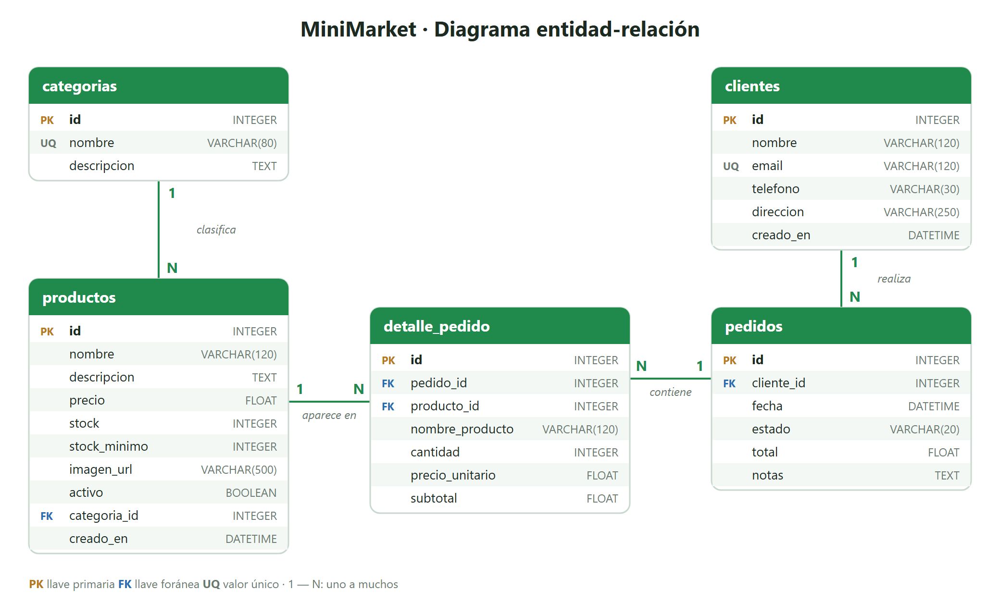

# MiniMarket — Análisis y diseño

## 1. Nombre del proyecto

**MiniMarket — Tienda en línea**

## 2. Descripción del problema

Muchas tiendas pequeñas de barrio (minisúpers, pulperías, abastecedores) llevan su inventario, precios y pedidos en cuadernos, hojas de cálculo sueltas o mensajes de WhatsApp. Esto provoca varios problemas:

- Se venden productos que ya no hay en bodega porque el inventario no se actualiza al vender.
- Los totales de los pedidos se calculan a mano y aparecen errores de cobro.
- Los clientes no tienen una forma sencilla de ver qué productos hay, sus precios ni el estado de su pedido.
- El dueño no sabe con rapidez qué productos debe reponer ni cuánto ha vendido.

## 3. Objetivo general

Desarrollar una aplicación web que permita a una tienda pequeña publicar su catálogo de productos, recibir pedidos en línea y administrar su inventario de forma centralizada, guardando toda la información en una base de datos SQLite a través de una API construida con Python y FastAPI.

### Objetivos específicos

1. Mostrar un catálogo de productos con imagen, precio, categoría y disponibilidad.
2. Permitir que el cliente arme un carrito y registre su pedido con sus datos de entrega.
3. Calcular automáticamente el total de cada compra y descontar las unidades del inventario.
4. Permitir que el cliente consulte sus pedidos y su estado.
5. Ofrecer un panel de administración para gestionar productos, categorías, pedidos y clientes (CRUD completo).
6. Alertar sobre productos con bajo stock y permitir registrar entradas y salidas de inventario.

## 4. Principales funcionalidades

| Módulo | Funcionalidad |
|---|---|
| Catálogo | Lista de productos con imagen y precio, búsqueda por texto y filtro por categoría. |
| Carrito | Agregar, cambiar cantidades y quitar productos; no permite pedir más unidades de las disponibles. |
| Pedidos (cliente) | Registro del pedido (checkout) y consulta de pedidos por email. |
| Administración | Inicio de sesión con contraseña. |
| Productos | Crear, consultar, modificar, ocultar y eliminar productos. |
| Inventario | Ver unidades y valor del inventario, alertas de bajo stock, entradas y salidas de stock. |
| Categorías | Crear, consultar, modificar y eliminar categorías. |
| Pedidos (admin) | Ver todos los pedidos, su detalle, cambiar el estado (pendiente → enviado → entregado, o cancelado) y eliminarlos. |
| Clientes | Crear, consultar, modificar y eliminar clientes. |
| Resumen | Ventas totales, cantidad de pedidos por estado, últimos pedidos y productos por reponer. |

### Reglas de negocio

- El total del pedido se calcula en el servidor, nunca en el navegador.
- Antes de registrar un pedido se verifica que haya stock suficiente de cada producto.
- Al registrar un pedido se descuentan las unidades del inventario.
- Al cancelar (o eliminar) un pedido que no fue entregado, las unidades regresan al inventario.
- Un pedido solo puede avanzar en este orden: `pendiente → enviado → entregado`. Puede cancelarse mientras no esté entregado.
- Cada línea del pedido guarda el nombre y el precio del producto en el momento de la compra, así el historial no cambia si luego se modifica o elimina el producto.
- No se puede eliminar una categoría que tiene productos ni un cliente que tiene pedidos.

## 5. Usuarios del sistema

| Usuario | Qué hace |
|---|---|
| **Cliente** | Navega el catálogo, arma su carrito, hace pedidos y consulta su estado. No necesita crear cuenta: se identifica con su email. |
| **Administrador** (dueño o encargado) | Entra al panel con contraseña y gestiona productos, inventario, categorías, pedidos y clientes. |

## 6. Diseño de la base de datos

### Tablas

#### `categorias`
Agrupa los productos del catálogo (Abarrotes, Bebidas, etc.).

| Campo | Tipo | Descripción |
|---|---|---|
| **id** (PK) | INTEGER | Identificador único. |
| nombre | VARCHAR(80), único | Nombre de la categoría. |
| descripcion | TEXT | Descripción opcional. |

#### `productos`
Productos que vende la tienda y su inventario.

| Campo | Tipo | Descripción |
|---|---|---|
| **id** (PK) | INTEGER | Identificador único. |
| nombre | VARCHAR(120) | Nombre del producto. |
| descripcion | TEXT | Descripción corta. |
| precio | FLOAT (≥ 0) | Precio de venta en colones. |
| stock | INTEGER (≥ 0) | Unidades disponibles. |
| stock_minimo | INTEGER | Si el stock llega a este número se marca como "bajo stock". |
| imagen_url | VARCHAR(500) | Enlace a la imagen del producto. |
| activo | BOOLEAN | Si se muestra en el catálogo. |
| *categoria_id* (FK) | INTEGER | Categoría a la que pertenece → `categorias.id`. |
| creado_en | DATETIME | Fecha de registro. |

#### `clientes`
Personas que han hecho pedidos.

| Campo | Tipo | Descripción |
|---|---|---|
| **id** (PK) | INTEGER | Identificador único. |
| nombre | VARCHAR(120) | Nombre completo. |
| email | VARCHAR(120), único | Correo; identifica al cliente. |
| telefono | VARCHAR(30) | Teléfono de contacto. |
| direccion | VARCHAR(250) | Dirección de entrega. |
| creado_en | DATETIME | Fecha de registro. |

#### `pedidos`
Encabezado de cada compra.

| Campo | Tipo | Descripción |
|---|---|---|
| **id** (PK) | INTEGER | Número de pedido. |
| *cliente_id* (FK) | INTEGER | Cliente que hizo el pedido → `clientes.id`. |
| fecha | DATETIME | Fecha y hora (UTC). |
| estado | VARCHAR(20) | `pendiente`, `enviado`, `entregado` o `cancelado`. |
| total | FLOAT | Suma de los subtotales. |
| notas | TEXT | Indicaciones de entrega. |

#### `detalle_pedido`
Cada producto incluido en un pedido (tabla intermedia entre `pedidos` y `productos`).

| Campo | Tipo | Descripción |
|---|---|---|
| **id** (PK) | INTEGER | Identificador único. |
| *pedido_id* (FK) | INTEGER | Pedido al que pertenece → `pedidos.id` (se borra junto con el pedido). |
| *producto_id* (FK) | INTEGER | Producto vendido → `productos.id` (queda vacío si el producto se elimina). |
| nombre_producto | VARCHAR(120) | Nombre del producto al momento de la compra. |
| cantidad | INTEGER (> 0) | Unidades compradas. |
| precio_unitario | FLOAT | Precio al momento de la compra. |
| subtotal | FLOAT | cantidad × precio_unitario. |

### Relaciones

| Relación | Tipo | Llave foránea | Regla al eliminar |
|---|---|---|---|
| categorias → productos | 1 a N | `productos.categoria_id` | RESTRICT: no se borra una categoría con productos. |
| clientes → pedidos | 1 a N | `pedidos.cliente_id` | RESTRICT: no se borra un cliente con pedidos. |
| pedidos → detalle_pedido | 1 a N | `detalle_pedido.pedido_id` | CASCADE: al borrar el pedido se borran sus líneas. |
| productos → detalle_pedido | 1 a N | `detalle_pedido.producto_id` | SET NULL: el historial se conserva. |

La relación entre `pedidos` y `productos` es **muchos a muchos** (un pedido tiene varios productos y un producto aparece en varios pedidos), y se resuelve con la tabla `detalle_pedido`.

El script SQL completo está en [`database/schema.sql`](../database/schema.sql).
